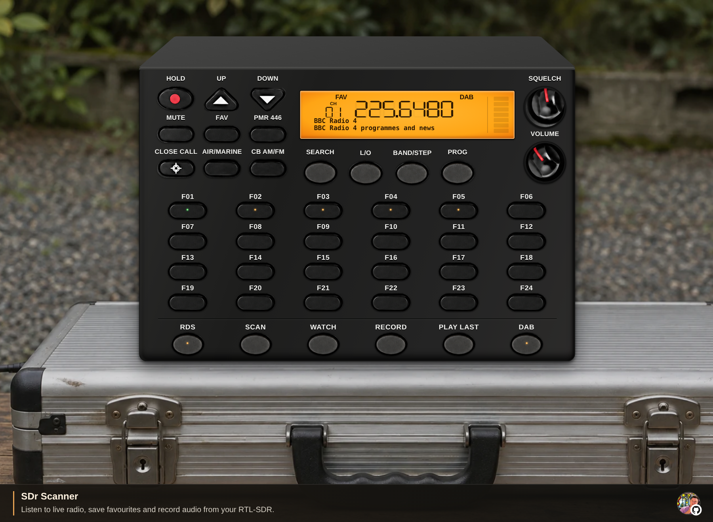
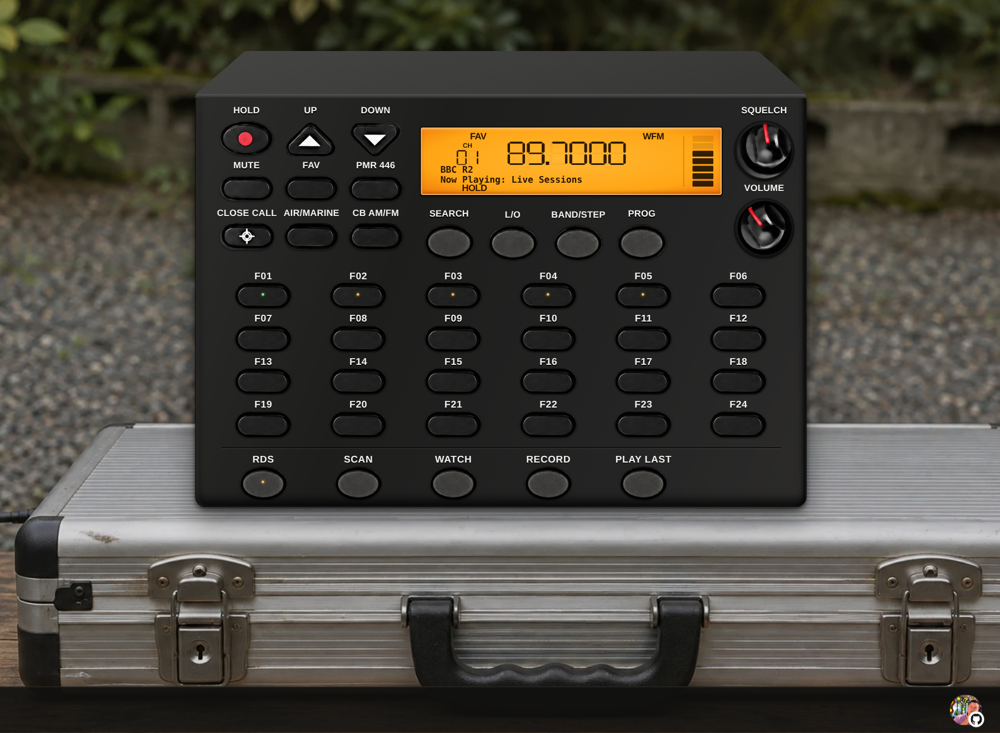
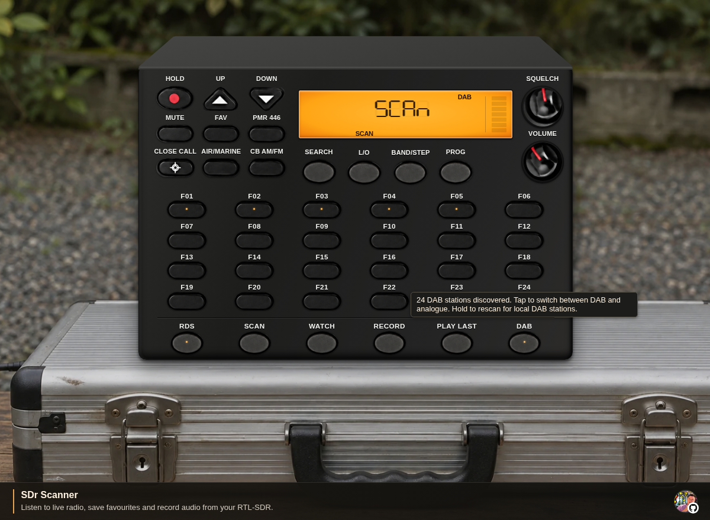
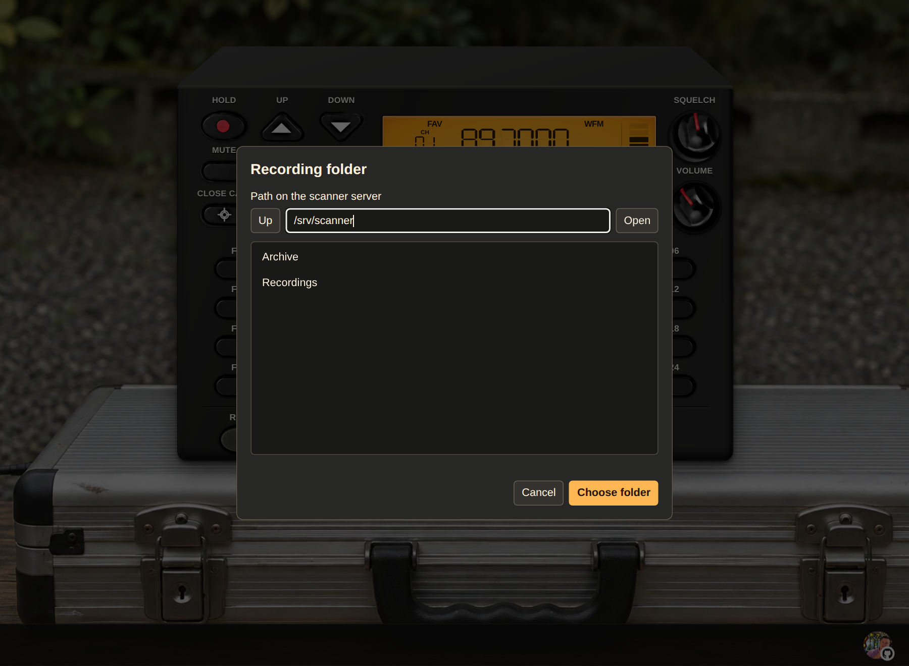
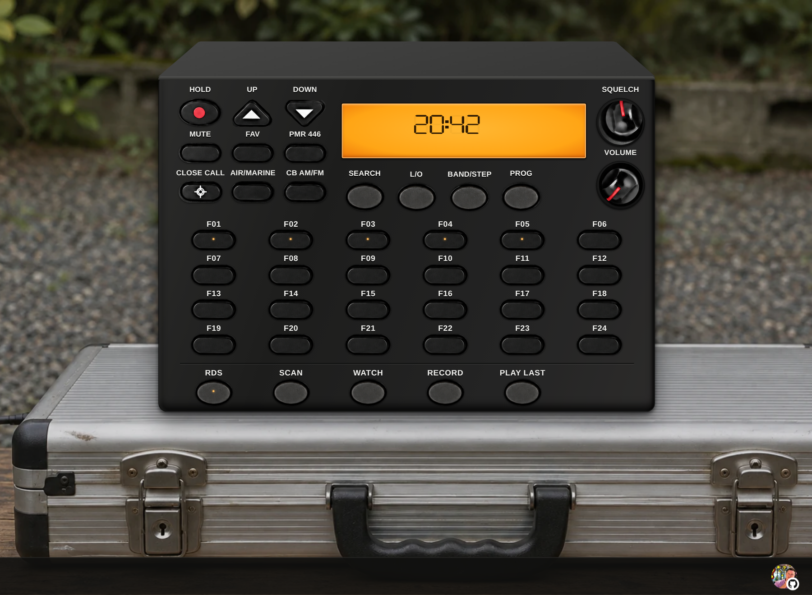

# SDr Scanner · Web-Based RTL-SDR Radio Scanner for Ubuntu and Debian

SDr Scanner turns a USB RTL-SDR dongle into a receive-only radio scanner you can use in a web browser. Install it on an Ubuntu or Debian desktop or headless Linux server, plug in a receiver such as the **Nooelec NESDR SMArt v5**, and listen from a computer, phone or tablet. The browser panel is modelled on the Uniden UBC-355CLT and includes DAB and DAB+ digital radio, broadcast FM with RDS, AM airband, marine VHF, PMR446 and CB radio.

[Download stable v5.0.1](https://github.com/AshCooperUK/SDR-Scanner/releases/tag/v5.0.1) · [Install on Ubuntu or Debian](#install-on-ubuntu-or-debian) · [Upgrade](#upgrade-an-existing-installation) · [Quick start](#open-the-panel-and-tune-your-first-station) · [Operating manual](#front-panel-controls) · [DAB setup](#install-the-optional-dab-decoder)



## Features

- **Receive DAB and DAB+ digital radio.** Hold **DAB** to scan Band III, then browse the discovered station list with **UP** and **DOWN**. See station names and scrolling text, save exact stations, and resume the last station after switching modes or restarting. DAB uses the [optional headless decoder](#install-the-optional-dab-decoder).
- **Receive conventional DMR voice and text.** Use the colour display for call metadata and incoming SMS. Save filtered DMR channels, log calls and replay clear audio. DMR uses the [optional DSD-neo decoder](#install-the-optional-dmr-decoder).
- **Listen to broadcast FM with RDS.** Tune wide FM and display the station name and RadioText when the broadcaster transmits them. Use the LCD digits for fine tuning and copy frequencies in MHz.
- **Scan AM airband, marine VHF, PMR446 and CB radio.** Scan presets or search **100 kHz to 1.75 GHz** with compatible hardware. Use adjustable squelch, a signal meter, temporary and permanent lockouts, and Close Call for strong nearby signals.
- **Save and watch favourites.** Store 124 analogue channels or DAB stations with 24 front-panel shortcuts. Use **WATCH** to check analogue favourites for activity, using a spare SDR when available.
- **Program the scanner from CHIRP.** Download an image of the scanner's analogue favourites, zones and radio settings, edit it in CHIRP and upload your changes.
- **Record and replay radio audio.** Save MP3 clips of at least two seconds with the frequency or DAB station name in the filename. Choose the server-side location in the browser and loop the latest clip with **PLAY LAST**.
- **Log and replay reception.** Open the **Discovery Log** on desktop, or hold **PLAY LAST** on mobile. See the time, frequency, mode and detected tone for each hit. **REPLAY** plays the most recent received audio.
- **Share the receiver over your private network.** Listen from multiple browsers without a scanner account. Each powered-on listener gets a separate USB receiver when one is available. Tabs sharing a receiver can mute independently. On phones, the panel fills the viewport in portrait and landscape.

## Contents

- [Install on Ubuntu or Debian](#install-on-ubuntu-or-debian)
- [Upgrade an existing installation](#upgrade-an-existing-installation)
- [Open the panel and tune your first station](#open-the-panel-and-tune-your-first-station)
- [Front-panel controls](#front-panel-controls)
- [Scan zones, search and lockouts](#scan-zones-search-and-lockouts)
- [Favourites and programming](#favourites-and-programming)
- [Program with CHIRP](#program-with-chirp)
- [RDS and Watch](#rds-and-watch)
- [DAB and DAB+](#dab-and-dab)
- [Install the optional DAB decoder](#install-the-optional-dab-decoder)
- [Conventional DMR](#conventional-dmr)
- [Install the optional DMR decoder](#install-the-optional-dmr-decoder)
- [Recording and playback](#recording-and-playback)
- [Discovery Log and instant replay](#discovery-log-and-instant-replay)
- [Close Call](#close-call)
- [Clock, band plans and memory reset](#clock-band-plans-and-memory-reset)
- [Service commands and backups](#service-commands-and-backups)
- [Access from another computer](#access-from-another-computer)
- [Share the scanner with multiple listeners](#share-the-scanner-with-multiple-listeners)
- [Troubleshooting](#troubleshooting)
- [Frequently asked questions](#frequently-asked-questions)
- [Uniden control reference](#uniden-control-reference)

## Install on Ubuntu or Debian

Use Ubuntu 22.04 or newer, or Debian 12 or newer, with Python 3.10 or newer and systemd. The dongle plugs into this Linux machine. You can use the panel in a browser on Windows, macOS or Linux.

**Recommended receiver** is the **Nooelec NESDR SMArt v5 SDR** for **100 kHz–1.75 GHz** coverage. Below 25 MHz the app uses direct sampling, which requires a receiver that supports it and an antenna suited to the frequency. [Nooelec receiver specifications](https://www.nooelec.com/store/nesdr-smart-sdr.html)

### 1. Install the packages and clone v5.0.1

Run these commands on the Linux machine that will host the scanner.

```bash
sudo apt update
sudo apt install --no-install-recommends git ca-certificates python3 python3-numpy \
  python3-scipy rtl-sdr libmp3lame0 libpam-systemd dbus-user-session iproute2
git clone --branch v5.0.1 --depth 1 https://github.com/AshCooperUK/SDR-Scanner.git
cd SDR-Scanner
```

The commands above install the stable release. For DMR, clone `main` using `git clone --branch main --depth 1 https://github.com/AshCooperUK/SDR-Scanner.git`, then follow the same installation steps and [install the DMR decoder](#install-the-optional-dmr-decoder).

The `rtl-sdr` package supplies the receiver tools, library and USB device rules. If APT cannot find it on Ubuntu, run `sudo apt install --no-install-recommends software-properties-common`, then `sudo add-apt-repository universe` and retry the installation. [Ubuntu package](https://packages.ubuntu.com/jammy/rtl-sdr) · [Debian package](https://packages.debian.org/bookworm/rtl-sdr)

On hosts where the `rtl-sdr` rule assigns the dongle to `plugdev`, add the service user with `sudo usermod -aG plugdev "$USER"`. Sign out and back in after changing groups or installing the systemd user-session packages. On an SSH-only host, reconnect the SSH session. Reconnect the USB dongle after the package install so the rule applies. [Debian RTL-SDR USB rules](https://sources.debian.org/src/rtl-sdr/0.6.0-4/rtl-sdr.rules) · [Debian systemd PAM package](https://packages.debian.org/bookworm/libpam-systemd)

### 2. Choose headless server or desktop

Return to the `SDR-Scanner` checkout if you signed out or reconnected over SSH. Run the installer as your normal user.

**Headless server**

```bash
/usr/bin/python3 launcher.py install --headless
```

The server installation runs the background service without a desktop environment, a browser or an applications-menu entry. Open the panel from another computer using the [SSH tunnel instructions](#access-from-another-computer).

**Ubuntu or Debian desktop**

```bash
sudo apt install --no-install-recommends xdg-utils
/usr/bin/python3 launcher.py install --desktop
```

Open **SDR Scanner** from your applications menu or visit [the local panel](http://127.0.0.1:8766/). The menu icon and browser tab use the maintainer's GitHub avatar. On desktops that show application actions, right-click the menu entry and choose **Stop SDR Scanner** to stop the service for the current boot.

With no flag, `launcher.py install` adds the icon if it detects a local X11 or Wayland session. It skips the icon over SSH or in a text console. Both modes start and enable the same systemd user service. The installer enables user lingering so the service can start at boot before login. If your system requires administrator permission for this step, run `sudo loginctl enable-linger "$USER"` and check `loginctl show-user "$USER" -p Linger` for `Linger=yes`.

### 3. Enable DAB and DAB+ if you want digital radio

Follow the [optional DAB decoder setup](#install-the-optional-dab-decoder) on the Linux machine with the receiver. The decoder runs without a desktop and uses the same scanner panel. For your first digital station, turn on **VOLUME**, hold **DAB** for about a second, and wait for the sweep to finish.

## Upgrade an existing installation

Open a terminal in your existing `SDR-Scanner` checkout. Run `git status --short` and save any local source edits before switching releases. Stop the service, then back up `.scanner-state.json`, `.scanner-radios/` if present, and your recording folders.

```bash
systemctl --user stop local-sdr-scanner.service
```

After backing up your data, fetch the release and start the scanner again.

```bash
git fetch origin tag v5.0.1
git switch --detach v5.0.1
systemctl --user start local-sdr-scanner.service
```

Refresh your browser after the restart. The panel opens in clock standby. The app keeps your favourites, recording location and other saved settings in the existing checkout. An in-place upgrade also keeps the paths in any private-network systemd drop-in valid. After upgrading from v5.0, hold **DAB** once to populate the full station list for the arrows. If this is your first DAB setup, [install the decoder](#install-the-optional-dab-decoder) first.

## Open the panel and tune your first station

1. Connect an antenna and plug the receiver into USB. Reconnect the dongle if it was plugged in when you installed `rtl-sdr`. Close any other SDR app using it.
2. Open [the panel](http://127.0.0.1:8766/) locally or follow [the remote access instructions](#access-from-another-computer). The app starts in clock standby.
3. Click **VOLUME** to power on and claim a receiver. A receiver starting from standby opens the first saved favourite in **HOLD**. Use **UP** and **DOWN** to browse saved analogue and DAB favourites. Adjust the volume and turn **SQUELCH** down until you can hear the signal. Turning **VOLUME** to zero returns this tab to clock standby and releases its assignment.
4. Click or hover over the LCD, type a local broadcast FM frequency in MHz such as `98.4`, and press **Enter**. The app tunes it in wide FM and enters **HOLD**. Turn on **RDS** to see the station details when available.
5. To stop **SCAN** or **SEARCH** on the current frequency, press **HOLD**. To resume, press **HOLD** again or use **SCAN** or **SEARCH** to select that operation.

| To do this | Start here |
| --- | --- |
| Listen to local digital radio | Install the [DAB decoder](#install-the-optional-dab-decoder), power on, and hold **DAB** once. When the sweep finishes, browse stations with **UP** and **DOWN**. |
| Listen to aircraft or PMR446 | Press **AIR/MARINE** or **PMR 446** to [scan a zone](#scan-zones-or-favourites). Press **HOLD** to stay on a channel. |
| Save a station for later | Hold one of **F01–F24**, or use **PROG → FAV** to [choose any memory slot](#save-or-erase-a-numbered-slot). |
| Record and listen back | Choose a destination with a right-click on **RECORD**, tap it to arm, then use **PLAY LAST** after the clip has finished. See [Recording and playback](#recording-and-playback). |
| Listen from a phone or another computer | Use the [private LAN or SSH setup](#access-from-another-computer). Power the browser panel on after opening it. |

### Tuning on the LCD

- **Type a frequency.** Enter MHz from `0.1` through `1750`, with up to six decimal places. Use **Backspace** to edit, **Enter** to tune and **Escape** to cancel. The segmented LCD displays up to five fractional digits.
- **Scroll a digit.** Point at a frequency digit and scroll up or down to add or subtract that place value. Scrolling up over the **2** in **12.3456** tunes **13.3456 MHz**. Scrolling down over the **9** in **98.7654** tunes **88.7654 MHz**. Scrolling elsewhere on the LCD steps by **100 Hz**. Wheel tuning enters **HOLD**.
- **Copy the tuned frequency.** Double-click the numeric readout to copy the exact frequency in MHz. In DAB, this copies the multiplex frequency.
- **See the current frequency.** Hover over or focus the LCD while **SCAN** or **SEARCH** advances to see the frequency being checked. **CH** identifies a memory slot or numbered preset. The LCD also shows active zones, **AM**, **NFM** or **WFM**, scan and search direction, lockout and Close Call status.
- **Modulation follows the frequency or zone.** Direct tuning uses mono wide FM from **87.5 to just below 108 MHz**, AM below **25 MHz** and in the **108–137 MHz** and **225–400 MHz** air ranges, and the band-plan mode or narrow FM elsewhere. Tuning within the CB range after selecting a CB channel preserves that channel's AM or FM mode.



## Front-panel controls

Hover over a control for its tooltip. **Tab** moves keyboard focus, and **Space** or **Enter** presses focused buttons. Hold the key down for a long press. With a dial focused, use the arrow keys for small adjustments, **Page Up** or **Page Down** for larger adjustments, and **Home** or **End** for its limits. **Space** or **Enter** also switches **VOLUME** between reception and standby.

| Control | What it does |
| --- | --- |
| **VOLUME** | Click to switch between reception and the standby clock. Scroll to adjust in small steps. Drag up or right to increase the volume and down or left to lower it. At zero this tab releases its receiver assignment. |
| **SQUELCH** | Sets the signal level that opens audio, pauses scan or search, and triggers recording or Watch. Drag, click around the outer part of the dial or scroll for **0.5 dB** wheel steps. Fully counterclockwise opens the audio gate. |
| **AUDIO BOOST** | Raises live audio in this browser by **0–12 dB**. Drag, scroll, or use the arrow keys. The tooltip shows the current boost in dB. |
| **HOLD** | Tap to pause on the current frequency or resume a scan or search. Hold for about a second to enter Favourites in **HOLD**. This keeps the current favourite if one is selected, or opens the first saved slot. In programming, **HOLD** cancels the pending operation. |
| **UP / DOWN** | During preset scanning, skips the current channel and keeps scanning in the chosen direction. In Search, sets the direction and moves past a hit. On Hold, steps channels or frequencies. After recalling a favourite, steps through saved analogue and DAB slots in slot order. In DAB, steps through discovered services across multiplexes. Hold an arrow for about a second for repeat stepping. |
| **DAB** | Below **HOLD**. Tap to switch between digital radio and analogue reception. Hold for about a second to rescan Band III for local stations. |
| **FAV / PMR 446 / AIR/MARINE / CB AM/FM** | Select a zone or favourites and start scanning. **FAV** also selects the memory destination during programming. |
| **CLOSE CALL** | Tap to cycle nearby-signal modes. Hold for about 2½ seconds for Close Call Only. Tap again in Only mode to open setup. |
| **BUSINESS / AMATEUR / FM RADIO** | Tap to toggle the zone. Hold **BUSINESS** or **AMATEUR** to search its full ranges. The LCD shows `BUS`, `HAM`, or `FM` for the selected zones. |
| **RAIL / EVENTS / UTILITIES** | Toggle the UK analogue voice zones. The LCD shows `RAIL`, `EVT`, or `UTIL`. |
| **SEARCH** | Sweeps an analogue frequency range and advances past a hit on a second press. |
| **L/O** | Tap for a temporary skip, double-tap for a permanent skip, or hold for about 2½ seconds to clear temporary skips and the current permanent lockout. |
| **USB/LSB** | Cycles upper sideband, lower sideband and automatic modulation for direct tuning and Search. |
| **TONE** | Tap to toggle CTCSS and DCS identification. Hold, then tap a saved narrow-FM **F01–F24** slot to set its tone squelch. |
| **BAND/STEP** | Tap to select a search range. Hold for about a second during Search to edit step sizes. It also backs out of Close Call setup or cancels a clock edit. |
| **PROG** | Starts or confirms memory programming. Hold for about 2½ seconds to toggle Program Lock in radio mode or set the clock in standby. Double-tap in standby on the scanner host to set the remote PIN. It also confirms step, band-plan and Close Call settings. |
| **DMR** | Immediately right of **PROG**. Opens the conventional DMR face. Tap **DMR** on that face to return to analogue or DAB. On a phone, the button is available from the slim panel. |
| **SAVE VOL** | Saves listening volume, Audio Boost, the listening squelch threshold and volume offset for the tuned channel in this browser. The saved volume also sets the default when powering on in a new tab. Hold or right-click to edit the offset in dB. |
| **F01–F24** | Tap to recall, hold for about a second to save an analogue frequency or DAB station, and right-click to name it. Middle-click temporarily locks out an analogue slot. |
| **ADV** | On a phone, switches between the slim panel and the full panel. The slim panel opens by default with the enlarged LCD, **HOLD**, **SEARCH**, **UP**, **DOWN**, the three dials and a numeric keypad. **L/O** is beside **0 - .**. Open the full panel for the waterfall and all 24 favourite buttons. |
| **1–9 / 0 - .** | Tap to enter a frequency in MHz. Hold **0 - .** for the decimal point. The scanner tunes 1.4 seconds after the last digit. Hold **1–9** to recall **F01–F09**. |
| **RDS** | Shows or hides FM RDS, DAB station details and custom favourite names on the LCD. |
| **SCAN** | Starts or resumes analogue scanning. Hold to choose which saved analogue favourites to scan. The SCAN LED flashes green while you select them. Hold **DAB** to discover digital stations. |
| **WATCH** | Tap while tuned to check F01–F24 in the background. Hold, or tap with no frequency tuned, to monitor those favourites in silent Watch mode. |
| **RECORD** | Tap to arm or stop recording clips of at least two seconds, right-click to choose the server folder, or hold for about 2½ seconds to delete clips for the tuned station or frequency. |
| **DISCOVERY** | Opens or closes the attached Discovery display. Its LED goes out when the display closes. |
| **REPLAY** | Plays up to 30 seconds of the most recent received audio once. Press again to stop. On mobile, use **Replay** in the Discovery Log. |
| **PLAY LAST** | Loops the latest saved recording in this browser. Press again for live audio. On mobile, hold to open the Discovery Log. |
| **MUTE** | To the right of **PLAY LAST**. Silences this browser and switches off its panel LEDs. The LCD stays readable at about 10% brightness. Other listeners and any armed recording continue. |

The bar on the right side of the LCD estimates usable signal strength. Hover over it for raw RF power, usable power when it differs, and carrier offset when available. A strong off-frequency signal can raise raw power while the usable bar drops. In wide FM, the meter and squelch also account for the noise floor. For a quiet standby between transmissions, hold a frequency and raise **SQUELCH** until the idle noise just disappears.

The amber waterfall below the frequency shows about eight seconds of live RF activity. The horizontal scale is in MHz. New readings appear at the top and stronger signals draw darker traces. Hover over the plot to see the frequency under the pointer. Click or tap a trace to tune and hold the analogue frequency at that point. The plot uses the same receiver as the audio and clears when the view changes frequency or the scanner sweeps between channels. Press **HOLD** to watch a fixed frequency. DAB uses the decoder’s spectrum when available. Clicking that plot switches to analogue tuning, and the **DAB** button returns to the last digital service.

Hover over **SQUELCH** to see the threshold in dBFS. Hover over an individual visible LCD symbol to see its name. Hover over a favourite to see its saved name, frequency and, for DAB, its multiplex block.

The avatar in the bottom-right footer opens the maintainer's GitHub profile. [AshCooperUK on GitHub](https://github.com/AshCooperUK)

## Scan zones, search and lockouts

### Scan zones or favourites

Press a zone button to start scanning. Several zones can be enabled together. Press **SCAN** to resume the selected zones from Hold or Search. With no selected zone, **SCAN** can start your saved FAV list. If no eligible channels are available, the panel shows `no Ch`.

Hold **SCAN** until the LCD shows `SEL FAV`. Tap saved analogue slots **F01–F24** to add or remove them. Selected, unlocked slots flash green while the scanner checks them. The **SCAN** LED flashes during selection and glows steady green in Scan mode, including when the scanner stops on an active channel. The selection window closes five seconds after the last tap and the chosen slots keep scanning. Hold **SCAN** again to change the selection. **HOLD** pauses the scan. Choose a zone or tune a frequency to leave it.

Hold **FAV** until the LCD shows `dEL FAV`. Tap any saved analogue or DAB slot **F01–F24** to delete its memory and name. The window closes five seconds after the last tap. Tap **FAV** normally to scan saved channels.

| Zone button | Selections |
| --- | --- |
| **FAV** | Scans saved analogue favourites in slots 1–124. Tap again in Scan to disable the zone. In DAB mode, **FAV** switches the arrows between discovered DAB stations and saved favourites. |
| **PMR 446** | All 16 analogue channels from **446.00625 to 446.19375 MHz** in **12.5 kHz** steps. Tap again in Scan to disable the zone. [Ofcom PMR446 channel plan](https://www.ofcom.org.uk/siteassets/resources/documents/manage-your-licence/business-radio/business-radio-guidance/ir_2009_analogue_and_digita1.pdf?v=335306) |
| **AIR/MARINE** | **Air AM + Marine NFM → Air AM → Marine NFM → Off**. Air covers the **108–137 MHz** grid with Norwich, CAA common channels and published UK AIP voice carriers first. Marine scans **145** voice frequencies including coastal, marina and onboard UHF channels. [UK AIP](https://nats-uk.ead-it.com/cms-nats/opencms/en/Publications/AIP/) · [UK CAA air channels](https://www.caa.co.uk/commercial-industry/airspace/communication-navigation-and-surveillance/aeronautical-radio-stations/) · [Ofcom maritime channel table](https://www.ofcom.org.uk/siteassets/resources/documents/manage-your-licence/ships/ship-radio-licences-guidance-notes-for-licensing.pdf?v=323115) · [Ofcom onboard UHF channels](https://www.ofcom.org.uk/siteassets/resources/documents/manage-your-licence/ships/emf-ship-licence-terms-and-conditions.pdf?v=325993) |
| **CB AM/FM** | **CB AM + CB FM → CB AM → CB FM → Off**. AM scans the **40 CEPT channels** at **26.965–27.405 MHz**. FM scans the **40 UK channels** at **27.60125–27.99125 MHz** and the **40 CEPT channels**. [Ofcom FM channel table](https://www.ofcom.org.uk/siteassets/resources/documents/spectrum/interface-requirements/ir_2027.pdf?v=335197) · [Ofcom AM channel table](https://www.ofcom.org.uk/siteassets/resources/documents/spectrum/interface-requirements/ir_2027.2.pdf?v=335215) |
| **BUSINESS** | **2,656** distinct narrow-FM frequencies from the supplied Ofcom register and the Simple UK, Simple Site and Suppliers Light licence schedules. Norfolk and East Anglia assignments come first. [Ofcom licence register](https://www.ofcom.org.uk/spectrum/frequencies/wtr) · [Ofcom licence schedules](https://www.ofcom.org.uk/spectrum/radio-equipment/business-radio-licence-management?language=en) |
| **AMATEUR** | **1,912** scan entries across narrow FM, AM, LSB and USB. Calling channels and selected Norfolk repeater outputs come first. The SSB section checks published 60 m USB spots and samples voice segments on 160 m through 23 cm. [RSGB band plans](https://rsgb.org/main/operating/band-plans/) · [RSGB 60 m guidance](https://rsgb.org/main/operating/band-plans/hf/5mhz/) · [RSGB repeater directory](https://ukrepeater.net/repeaterlist.html?filter=ANALOGUE) |
| **FM RADIO** | **87.5–107.9 MHz** in **100 kHz** steps using wide FM, with selected North Norfolk broadcasts first. [Ofcom broadcast transmitter data](https://www.ofcom.org.uk/tv-radio-and-on-demand/coverage-and-transmitters/radio-tech-parameters) |
| **RAIL** | **259** UK railway and tram analogue voice frequencies, with East Anglia first. [Ofcom licence register](https://www.ofcom.org.uk/spectrum/frequencies/wtr) · [ORR rail operators](https://dataportal.orr.gov.uk/statistics/external-links/industry-groups-and-operators/) |
| **EVENTS** | **402** UK venue, event and production talkback voice frequencies, with East Anglia first. [Ofcom licence register](https://www.ofcom.org.uk/spectrum/frequencies/wtr) · [Ofcom OB talkback](https://www.ofcom.org.uk/spectrum/radio-equipment/ob-talkback) · [Ofcom fixed-site talkback](https://www.ofcom.org.uk/spectrum/radio-equipment/fixed-site-talkback) · [Ofcom Channel 21](https://www.ofcom.org.uk/spectrum/radio-equipment/channel-21) |
| **UTILITIES** | **697** UK water and power utility analogue voice frequencies, with East Anglia first. [Ofcom licence register](https://www.ofcom.org.uk/spectrum/frequencies/wtr) |

The land-mobile zones use live, publishable analogue voice records from the Ofcom register snapshot dated 13 November 2026. The three sector zones group assignments by public licensee names because the register has no industry field. The frequencies are built in and work offline. A full pass takes longer on larger zones, and the scanner pauses when a signal opens the squelch. Contains Ofcom copyright data derived from the [Wireless Telegraphy Register](https://www.ofcom.org.uk/about-ofcom/our-research/opendata#spectrum-open-data).

The Amateur zone switches modulation automatically for each entry. SSB voices can fall between the 2.5 kHz scan points. Press **HOLD** and scroll the LCD to fine-tune while keeping USB or LSB. [RSGB band plans](https://rsgb.org/main/operating/band-plans/)

While scanning, `SCAN` scrolls and the current zone label flashes. When reception ends, the scanner waits about two seconds for a reply before moving on. **HOLD** stays on the current channel after the signal ends. Disabling the last enabled zone returns to the last held frequency if one is available.

### Search the full Amateur or Business zone

1. Hold **AMATEUR** or **BUSINESS** for about a second. The LCD shows `HAM` or `BUS` with `SEARCH` and a direction arrow. The search starts from the current frequency and skips the gaps between ranges.
2. To search a single range, tap **BAND/STEP**, then choose with **UP**, **DOWN** or repeated **BAND/STEP** taps. Tap **SEARCH** to begin or wait about three seconds. Choose `HAM ALL` or `BUS ALL` to include every range in the zone.
3. During the search, **UP** and **DOWN** set direction, **SEARCH** moves past a hit, and **HOLD** keeps the current frequency. Tap the zone button to return to its presets. Hold **BAND/STEP** to change the grid and use **USB/LSB** to override the automatic modulation.

Amateur covers **27** UK allocations from the 136 kHz band through 23 cm, including the separate 60 m segments. Business covers **10** Ofcom ranges and checks the exact WTR and licence-schedule frequencies alongside the grid. Full searches take several minutes and can stop on signals from other services in shared ranges. The scanner demodulates analogue audio, so a hit in a data or digital voice segment may be audible as noise. [Ofcom amateur licence schedule](https://www.ofcom.org.uk/siteassets/resources/documents/spectrum/emf/emf-amateur-licence-terms-and-conditions.pdf?v=386197) · [Ofcom Business Radio IR 2044](https://www.ofcom.org.uk/siteassets/resources/documents/spectrum/interface-requirements/ir2044.pdf?v=335177)

### Search frequencies and change the step

- Tap **SEARCH** from Scan to sweep **100 kHz–1.75 GHz**, starting from the current frequency in the selected direction. For example, from Scan, enter `102.4` on the LCD and then press **SEARCH** to begin from that part of the band. If you are already using a preset search range, select **ALL** for a full sweep. **UP** and **DOWN** change the direction while the sweep runs. **Auto** uses a **12.5 kHz** step for the full sweep.
- To pick a narrower range, tap **BAND/STEP** and use **UP**, **DOWN** or repeated **BAND/STEP** taps while the range label is on screen. The app offers **31 ranges** in frequency order, from **0.1–25 MHz** to **960–1750 MHz**, plus **ALL**. Press **SEARCH** or wait about three seconds to begin. Press **SEARCH** again to move past a hit or **HOLD** to keep listening.
- To set spacing, hold **BAND/STEP** while in Search. Use the arrows to choose **Auto, 5, 6.25, 10 or 12.5 kHz**. Tap **BAND/STEP** inside this menu to switch to the Air spacing, then choose **8.33 or 12.5 kHz** with the arrows. Press **PROG** or wait about three seconds to save and restart the search at the range boundary. Air spacing also changes the Air zone grid.
- The sweep checks discrete frequencies. Smaller steps take longer, and coverage and retune speed depend on the receiver. For an exact frequency between grid points, use [LCD tuning](#tuning-on-the-lcd).

### Scan with sideband, tone search and saved audio levels

- **Sideband search.** Tap **USB/LSB** to choose the sideband, tune near the band you want, then tap **SEARCH** to start from there. For a smaller sweep, use **BAND/STEP** to select a range. While searching in USB or LSB, hold **BAND/STEP** to choose **100 Hz, 500 Hz, 1 kHz or 2.5 kHz** spacing. The default is **1 kHz**. Press **PROG** or wait about three seconds to apply it. Use **HOLD** and LCD wheel tuning to clarify a voice hit. Tap **USB/LSB** through to **Auto** to restore band-based modulation.
- **Scan saved channels.** While held on a USB or LSB signal, hold a favourite button to save it. Scan your favourites or hold **SCAN** to choose individual slots. Saved channels keep their own modulation, so an analogue scan can mix sideband and narrow FM.
- **Identify tones while scanning.** Enable **TONE** before a preset scan or narrow-FM search. When squelch opens, the LCD shows the CTCSS frequency or DCS code if one is detected. DCS aliases appear in the tooltip when the received pattern has two equivalent labels.
- **Save tone squelch.** Hold **TONE**, then tap a saved narrow-FM favourite in **F01–F24**. Enter a CTCSS frequency or a three-digit DCS code and polarity. **Use detected tone** copies the result when you are tuned to that frequency and a tone is available. Choose **Carrier only** to clear the filter. The saved filter applies during favourite recall and scanning even with the **TONE** search display off. The scan checks for a match for up to about three-quarters of a second after carrier squelch opens. Only matching signals open audio and recording. **WATCH** continues to report RF activity.
- **Save listening levels.** Tune a channel or press **HOLD** on a hit, adjust the dials and tap **SAVE VOL**. Hold or right-click **SAVE VOL** to set a **−12 to +12 dB** channel offset. The settings return when this browser tunes the channel or stops on it during a scan. A saved listening squelch can mute audio in this browser when a signal is below its threshold. The receiver squelch still controls scanning and recording.

### Skip and restore channels

| L/O gesture | Result |
| --- | --- |
| **Tap** | Temporarily skips the current channel or frequency and shows `T L/O`. When held on a temporary skip, a tap restores it. Clock standby also clears temporary skips. |
| **Quick double-tap** | Permanently skips the item and shows `L/O`. The exclusion is saved across restarts. |
| **Hold for about 2½ seconds** | Clears **all temporary skips**. If the tuned item has a permanent lockout, it clears that item's permanent lockout too. |

To unlock a permanently excluded favourite, recall it directly or step to its saved slot, then hold **L/O**. For a skipped frequency, type its frequency into the LCD and hold **L/O**. Each saved FAV slot has its own exclusion. Factory presets and Search use shared frequency exclusions, with space for 100 temporary and 100 permanent frequencies. The oldest exclusion of that type drops out when the list is full.

## Favourites and programming

### Use F01–F24

1. Tune a frequency and press **HOLD** if you are scanning or searching.
2. Hold **F01–F24** for about a second to save the frequency and modulation to that slot. A lit amber LED shows the slot is saved. If a broadcast station name has already decoded with **RDS** enabled, it can fill in the favourite name automatically.
3. Tap a saved button to recall and hold it. A matching frequency lights green whenever the receiver tunes it, including when Scan or Search reaches it. Hover to see the name followed by the saved frequency.
4. To rename a slot, right-click its button and type in the LCD. **Enter** saves, **Escape** cancels, and saving an empty name clears it. The panel label stays **F01**, **F02** and so on.

While listening to DAB, hold a favourite button to store the exact station and its name. Each slot holds one analogue channel or DAB station. Tapping a DAB favourite also works from analogue mode. Its LED turns green only when the saved DAB station is selected.

### Save or erase a numbered slot

**Save to slot 99** works the same way as any of the 124 slots.

1. Tune and hold the frequency.
2. Tap **PROG**, then **FAV**. The LCD alternates between the source frequency and the destination slot. It starts at the first empty slot, or slot 1 when all slots are occupied.
3. Tap or hold **UP** or **DOWN** until the slot display shows `CH 99`. Slot selection wraps around. Tap **PROG** to save and hold that slot. **HOLD** cancels before writing.

Slots **1–24** are the same memories as **F01–F24**. The next 100 slots are available through **PROG** and the arrows. Existing Emergency memories from older versions map to **25–124**. After recalling a favourite, use the arrows to step through saved analogue and DAB slots in either direction. The arrows skip empty slots, include those beyond F24 and wrap at both ends.

To save a DAB station in any slot, listen to it and use **PROG → FAV → UP/DOWN → PROG**. While in DAB, tap **FAV** to switch between discovered DAB stations and the saved favourite list.

**Erase one slot.** In analogue mode, tap **PROG**, then hold **L/O** for about 2½ seconds **before** pressing **FAV**. This loads `000.0000` as the source. Select an analogue or DAB slot and tap **PROG** to erase it. You can also clear an F01–F24 name separately through its right-click editor.

**Program Lock.** While powered on, hold **PROG** for about 2½ seconds to toggle the **PROG** memory-writing sequence. `Pg.L` means locked, and `OF Pg.L` means unlocked.

## Program with CHIRP

Run CHIRP on the computer hosting SDr Scanner. The scanner service needs to be running. These steps use the supplied [SDr Scanner CHIRP driver](chirp_sdr_scanner.py).

1. In CHIRP, enable **Help → Developer Mode**, then choose **File → Load Module** and open `chirp_sdr_scanner.py` from the scanner checkout. If the menu is missing, restart CHIRP after enabling Developer Mode.
2. Choose **Radio → Download From Radio**. Under **Port**, select **Custom…** and enter `socket://127.0.0.1:8766`. Use your configured port if it differs. Select **SDr Scanner** as vendor and **Web Scanner** as model, then download.
3. Edit analogue favourites in **Favourites**, scan channels in the named zone editors, and radio configuration in **Settings**. Save a copy of the downloaded CHIRP image if you want to keep the original entries for reference.
4. Choose **Radio → Upload To Radio** and use the same port. If the scanner reports that its programming has changed since the download, download a fresh image and reapply the desired edits.

Favourites use scanner slots **1–124**, with **1–24** matching **F01–F24**. DAB favourites remain on the scanner and occupy protected slots. Zone edits change the preset lists used by a tap of the corresponding zone button. The full Amateur and Business range searches still use their published frequency ranges. Settings include the band plan, frequency steps, RDS, clock offset, Program Lock and Close Call options. Programming applies to the primary receiver and works while the panel is in standby.

**Copy channels from another radio.** Open the other radio's image in CHIRP, copy the rows you want, then select the starting slot in **Memories (Favourites)** and paste. The scanner uses the receive frequency, mode, name and any supported receive tone. Transmit offsets and transmit-only tones are discarded. Choose slots that are free of DAB favourites.

**Remote Access.** Download a fresh image and open **Settings → Remote Access**. Set **Remote URL** to the one address you use away from home, such as `https://scanner.example.com`, and enter a **New six-digit PIN** if you want to set or change it. Leave the PIN blank to keep the existing one. Choose **Radio → Upload To Radio** to apply the changes. The PIN is entered again if you close CHIRP before uploading because the image does not store it.

The configured URL requires the PIN. Other remote URLs are blocked. Direct connections from the scanner's LAN and known Tailscale peers still work without a PIN. To use the scanner only on those networks, clear **Remote URL** and upload. If the URL has never been configured, also tick **Block remote access when URL is blank** to switch from the original policy to local-only access. A PIN or URL change clears existing remote unlocks.

## RDS and Watch

**RDS.** Turn on **RDS** and hold a wide-FM station that broadcasts RDS. The LCD reserves two lines for a station name and broadcast text. Long text scrolls, and the LCD stays the same size. Allow several seconds for the data to decode. A custom F01–F24 name takes the place of the station-name line and can appear for any modulation when the tuned frequency matches. Turning **RDS** off hides broadcast details and custom names on the LCD. Saved names remain in favourite tooltips.

**WATCH.** Tap **WATCH** while tuned to check unlocked analogue favourites in F01–F24 in the background. Hold **WATCH**, or tap it when no frequency is tuned, to pause current reception and monitor those favourites in silent Watch mode. It spends about half a second checking each slot. A matching favourite LED flashes amber when its signal exceeds the squelch setting. Hover over the LCD to see the slot and frequency being checked. Tap **WATCH** again to resume your previous tuning.

Hold **L/O** during silent Watch mode to clear temporary lockouts.

- With a spare RTL-SDR plugged into the host, Watch opens it automatically. Your receiver stays on the frequency you are listening to. An independent listener takes priority if they need the spare.
- With one SDR, nearby checks can use the current tuner capture. More distant background checks can briefly retune and interrupt live audio. Close Call takes priority over background checks. Watch checks are brief samples, so a short transmission can end between checks.

## DAB and DAB+

1. On first use, hold **DAB** to discover stations on Band III. Each multiplex is a group of stations broadcast on the same frequency. After discovery, tap **DAB** to return to the last playable station. The station list is saved across service restarts.
2. Use **UP** and **DOWN** to browse the discovered station list. The arrows wrap at either end and tune the selected station directly.
3. Turn **RDS** on to show the DAB station name and scrolling broadcast text on the LCD. Hold a favourite button to save the exact station, or use **PROG → FAV** for a numbered slot.
4. Tap **DAB** again to return to analogue reception. Tap a saved DAB favourite from analogue mode to go straight to that station.

**Find more stations.** Hold **DAB** for about a second to run one sweep of all 38 Band III blocks. Audio pauses during the sweep, which can take several minutes. The scanner gives previously discovered multiplexes extra time to identify their stations. When it finishes, it resumes the previous station if it was found, or tunes the first discovered station. If a sweep finds nothing, it keeps the saved list and tries to resume the previous station. Hover over **DAB** to see the total number of discovered audio services. During the sweep, the tooltip shows the last completed count.



| DAB control | What to expect |
| --- | --- |
| **Hold DAB** | Discover stations across Band III and refresh the stored list. |
| **Tap DAB** | Switch between analogue reception and the last playable digital station. `LOADING` appears while tuning. `no Ch` means there is no saved station to resume. |
| **UP / DOWN** | Move to the next or previous discovered service, including across multiplexes. After recalling a favourite, the arrows step through saved slots instead. Both lists wrap at either end. |
| **FAV** | Switch between the full discovered list and saved favourites. |
| **RDS** | Show or hide the station name and scrolling digital broadcast text. |

**SCAN** and **SEARCH** are analogue controls. For digital station discovery, hold **DAB**.

DAB playback and recordings are mono. Audio opens when the decoder receives valid audio from the selected service.

### Install the optional DAB decoder

Run these commands on the Linux host, as the same user who runs the scanner service. The build produces the headless `welle-cli` decoder and binds its internal HTTP listener to loopback. [welle-cli v2.7 source](https://github.com/AlbrechtL/welle.io/tree/v2.7)

```bash
sudo apt install --no-install-recommends build-essential cmake xxd \
  libfaad-dev libmpg123-dev libmp3lame-dev gstreamer1.0-tools \
  gstreamer1.0-plugins-base gstreamer1.0-plugins-good

(
  set -eu
  dab_build_dir=$(mktemp -d)
  trap 'rm -rf -- "$dab_build_dir"' EXIT
  git clone --depth 1 --branch v2.7 https://github.com/AlbrechtL/welle.io.git "$dab_build_dir/source"
  dab_socket="$dab_build_dir/source/src/various/Socket.cpp"
  sed -i 's/htons(INADDR_ANY)/htonl(INADDR_LOOPBACK)/' "$dab_socket"
  grep -q 'htonl(INADDR_LOOPBACK)' "$dab_socket"
  cmake -S "$dab_build_dir/source" -B "$dab_build_dir/build" \
    -DCMAKE_POLICY_VERSION_MINIMUM=3.5 -DBUILD_WELLE_IO=OFF -DBUILD_WELLE_CLI=ON \
    -DKISS_FFT=ON -DRTLSDR=OFF -DSOAPYSDR=OFF
  cmake --build "$dab_build_dir/build" --parallel 2
  install -D -m 0755 "$dab_build_dir/build/welle-cli" "$HOME/.local/share/sdr-scanner/bin/welle-cli"
)
```

The build installs the decoder to `~/.local/share/sdr-scanner/bin/welle-cli`. Power on the panel and hold **DAB** to discover your first stations. If the LCD shows `Err`, hover over **DAB** for the decoder message.

## Conventional DMR

1. Use the `main` branch and install the DMR decoder on the computer with the RTL-SDR attached. Open **DMR** beside **PROG**, then turn up **VOLUME** if the radio is in standby.
2. Enter the receive frequency in MHz and press **E / YES**. On a keyboard, type the frequency and press **Enter**. The display shows **CC** (colour code), **TS** (time slot), **TGID** (talkgroup) and **UNIT ID** once a call provides those fields. Squelch and the selected filters determine when clear voice plays.
3. Press the **SQUELCH** dial to open the menu on the radio's LCD, then select **Program a channel** to save the frequency and name. Set a colour code, slot or talkgroup to restrict reception. Leave a filter blank to accept any value. **FAV** lists the saved DMR channels. Use **SYSTEM** or **DEPT** to limit a scan to the selected favourite's group, and press the same key again to release that limit. **SCAN** checks the saved channels.
4. Press **FUNC → SEARCH** to set a frequency range and step. **SEARCH** starts the sweep. Press it again to hold the current frequency.
5. Use **DISCOVERY** to see previous DMR calls with their frequency, colour code, time slot, talkgroup and source radio ID. **REPLAY / REC** replays recent audio. **FUNC → REPLAY / REC** arms recording. **AVOID** skips the current selection temporarily, and **FUNC → AVOID** saves the skip. Use the menu to clear avoids.
6. Press **DMR** to return to the previous scanner mode. DMR favourites are stored on the scanner host, separately from the analogue and DAB favourites and the CHIRP image.

This mode receives clear conventional DMR voice, one call at a time. Trunked-system control-channel following and encrypted voice playback are outside its scope. Scan and search need a live DMR transmission with enough dwell time to decode it.

For handheld-to-scanner simplex testing, tune to the handheld's TX frequency and leave **Time slot** set to **Any**. Some direct-mode calls carry no verified slot number. The LCD leaves the slot blank while playing those calls.

### Receive DMR SMS

1. Open **DMR** and hold on the frequency carrying the text. For a direct test, use the handheld's transmit frequency and leave **Time slot** on **Any**.
2. On the handheld, select **DMR Standard** text messaging if it offers a format choice and send a short, clear test message to another radio ID.
3. Press **SQUELCH → SMS** on the scanner. Select a message to see its text, sender, destination and receive frequency.
4. To remove a message from the receiver's inbox, open it and press **DELETE**, then **YES**.

The scanner keeps the latest 24 decoded messages for each receiver in memory until the service restarts. The RTL-SDR receives compatible, unencrypted messages and has no transmit capability. The scanner must hear the full radio packet. [FreeDMR SMS format guide](https://www.freedmr.uk/index.php/sms-messages/)

While Discovery logging is enabled, it also records the time, frequency, sender and recipient IDs, and any known colour code or slot for each received SMS. Message text stays in the inbox.

### Install the optional DMR decoder

On 64-bit Intel or AMD Ubuntu or Debian, install `curl` with `sudo apt install --no-install-recommends curl`. Run the following as the user who runs the scanner service. The release bundle is extracted so the decoder can run without a GUI or a FUSE mount. [DSD-neo v2.12.1 release](https://github.com/arancormonk/dsd-neo/releases/tag/v2.12.1)

```bash
(
  set -eu
  dmr_work_dir=$(mktemp -d)
  trap 'rm -rf -- "$dmr_work_dir"' EXIT
  dmr_data_dir="${XDG_DATA_HOME:-$HOME/.local/share}/sdr-scanner"
  cd "$dmr_work_dir"
  curl -fL -o dsd-neo.AppImage \
    https://github.com/arancormonk/dsd-neo/releases/download/v2.12.1/dsd-neo-linux-x86_64-portable-v2.12.1.AppImage
  printf '%s  %s\n' 3110c5bcf8572789d57dd96ef09c351a61e2d1b1a4cf156ac542b0b3e73053a6 dsd-neo.AppImage | sha256sum -c -
  chmod +x dsd-neo.AppImage
  ./dsd-neo.AppImage --appimage-extract > /dev/null
  mkdir -p "$dmr_data_dir/bin"
  if [ ! -e "$dmr_data_dir/dsd-neo-2.12.1" ]; then
    mv squashfs-root "$dmr_data_dir/dsd-neo-2.12.1"
  fi
  ln -sfn "$dmr_data_dir/dsd-neo-2.12.1/AppRun" "$dmr_data_dir/bin/dsd-neo"
)
```

For other architectures, install a suitable DSD-neo 2.12.1 build and put `dsd-neo` on the scanner service's `PATH`, or set `SDR_SCANNER_DMR_DECODER` in its environment to the executable's full path. [DSD-neo source and build instructions](https://github.com/arancormonk/dsd-neo/tree/v2.12.1)

## Recording and playback

**Arm recording.** Tap **RECORD**. Its LED flashes red while capturing audio above squelch. A clip is finalised when the signal ends, the tuner changes frequency, or you stop recording. Captures shorter than two seconds are discarded. Kept clips include the opening audio and use the receiver audio even while the browser is muted. The app also skips identifiable short, isolated AM or narrow-FM beep bursts. Clips with speech retain their original audio, including any courtesy tone.

**Choose a folder.** Right-click **RECORD**. In the browser picker, open a listed subfolder, use **Up**, or enter an absolute server path and select **Open**. Choose a writable location and click **Choose folder**. The picker works from a Windows browser connected to a headless Linux host, and the folders are on the host where the SDR is attached.



| Reception | Example path under the chosen folder |
| --- | --- |
| Analogue | `Recorded Audio/446.00625mhz-140915-13112026.mp3` |
| DAB with no displayed station name | `Recorded Audio/222.0640mhz-143059-13112026.mp3` |
| DAB with **RDS** on and a displayed station name | `Recorded Audio/GB News Radio-143059-13112026.mp3` |

New clips go directly into **Recorded Audio** and use the frequency or station name followed by `HHMMSS-DDMMYYYY.mp3`. Times follow the server's local clock. If you choose an existing folder named `Recorded Audio`, the app uses it directly. The default is `recordings/Recorded Audio` beside the scanner state file.

**Play the latest clip.** Tap **PLAY LAST** to loop the latest finished clip in the selected location, including older clips saved in station or frequency subfolders. Playback takes over live sound and panel tones in that browser. The tuner and recording continue to operate. **MUTE** also silences playback. Tap **PLAY LAST** again to stop the loop and return to live audio.

**Delete recordings.** Tune to the station or hold the exact frequency, then hold **RECORD** for about 2½ seconds. The scanner clears matching clips in **Recorded Audio** and in any matching legacy subfolder. DAB clips carry the station ID so deletion is limited to the selected service. Older DAB clips without an ID remain playable and can be removed manually. Use the same **RDS** setting and displayed name as when you recorded the clip. If recording is armed and audio is open when you delete, the app waits for that audio to end before recording there again.

## Discovery Log and instant replay

Tap **DISCOVERY** on desktop to open the attached amber LCD. On a phone, tap **ADV** to show the full panel, then hold **PLAY LAST**. Opening the log while powered on starts logging the first time. Tap **PAUSE LOG** to pause or resume. Its LED lights while logging is paused. **CLOSE** hides the display and logging continues in the background if enabled.

Discovery logs analogue reception whenever the receiver's squelch opens, including on held frequencies, manually tuned channels and Close Call hits. It also logs DAB when the selected station is delivering decoded audio. The top of the LCD shows the frequency, mode and any detected tone during reception and clears when it ends. The log lists up to 100 hits, with ten rows per page. **M** shows the mode and **T** shows the tone. Use **PAGE DOWN** for older hits and **PAGE UP** to return to newer ones. Buttons beside empty rows are disabled.

Tap **PLAY** next to a hit to hear audio still in the replay buffer. Tap **REC** to save that buffered audio as an MP3 in the folder selected with **RECORD**. Its red LED lights while saving and stays lit after a successful save. At least two seconds of buffered audio are required. The filename uses the hit's frequency or displayed DAB station name and its original start time, for example `446.00625mhz-140915-13112026.mp3`.

**REPLAY** plays up to 30 seconds of recent received audio, omitting gaps when the audio gate was closed. On mobile, tap **Replay** on the Discovery display. Live audio returns when replay ends. **RECORD** is independent. The replay buffer and Discovery Log stay in memory for each receiver and clear when the scanner service restarts.

## Close Call

Close Call uses the main SDR to detect strong nearby signals in selected frequency groups.

| Mode | How it behaves |
| --- | --- |
| **Off** | Normal scan, search or reception. |
| **Do Not Disturb** | Checks for nearby signals about every two seconds while the current channel is quiet. |
| **Priority** | Checks about every two seconds, including during reception. This can cause a brief audio gap. |
| **Only** | Checks for nearby signals by itself. The LCD shows dashes and a flashing Close Call icon while waiting. |

Tap **CLOSE CALL** to cycle **Off → Do Not Disturb → Priority → Off**. Hold it for about 2½ seconds for **Only**. Select **SCAN**, **SEARCH**, a zone or a frequency to leave Only and return to the previous Close Call mode.

On a hit, the LCD flashes `b1 Found` or the corresponding band number. Press **HOLD** once to reveal the frequency and again to stay on it. Use **PROG** to save the hit or **CLOSE CALL** to dismiss it and continue.

**Settings.** In Close Call Only, tap **CLOSE CALL** to open setup. Use **UP** and **DOWN** to choose `C-C.bnd` for the frequency groups or `C-C.ALt` for the alert beep. Press **PROG** to open the choice. For bands, choose a group with the arrows and press **PROG** again. Set `On` or `OFF` with the arrows and save with **PROG**. **BAND/STEP** goes back one level and **CLOSE CALL** exits setup. Turning all bands off re-enables **b1 Lo**.

| Group | Range in MHz |
| --- | --- |
| b1 Lo | 25.000–87.295 |
| b2 Air | 108.000–136.991667 |
| b3 Hi | 137.000–174.000 |
| b4 UHF | 406.000–512.000 |
| b5 800 | 806.000–960.000 |

## Clock, band plans and memory reset



**Set the clock.** Click **VOLUME** to enter standby, then hold **PROG** for about 2½ seconds. Tap **UP** or **DOWN** to adjust by one minute, or hold an arrow to repeat in 15-minute increments. **PROG** saves and **BAND/STEP** cancels. The edit times out after three minutes of inactivity. The clock follows the host's local time with your saved offset and the backlight fades after about three seconds in standby.

**Select a band plan.** In standby, hold **HOLD** and **DOWN** together while turning on **VOLUME**. Select **Plan 1** for the UK/international search grid or **Plan 2** for the German grid using **UP** and **DOWN**. Press **PROG** to save or **BAND/STEP** to cancel. Click **VOLUME** to begin reception. The preset search grids are listed in the [band-plan source](bandplan.py).

> **Memory reset erases your saved channels and names.** To reset, go to clock standby, hold **L/O** and **PROG** together, then turn on **VOLUME** while both are held. The panel briefly shows `Clear`. It erases programmed memories, favourite names and lockouts, and turns off Program Lock. Back up the state file first if you want to restore those memories later.

For either standby combination, you can hold the two buttons on a touchscreen while tapping **VOLUME**. On a keyboard, focus the first button and hold **Space**, use **Tab** to reach the second and hold **Enter**, then click **VOLUME** with the mouse before releasing both keys.

## Service commands and backups

Run these as the user who installed the scanner.

```bash
systemctl --user status local-sdr-scanner.service
systemctl --user stop local-sdr-scanner.service
systemctl --user start local-sdr-scanner.service
systemctl --user restart local-sdr-scanner.service
journalctl --user -u local-sdr-scanner.service -n 50
```

From the repo, `/usr/bin/python3 launcher.py open` starts the service if needed and opens the browser on a local desktop. On a headless session or over SSH, it prints the local URL. `/usr/bin/python3 launcher.py stop` stops the service for the current boot. To also disable future automatic starts, use `systemctl --user disable --now local-sdr-scanner.service`.

For a foreground session, stop the service, run `/usr/bin/python3 app.py` from the checkout, and open [the local panel](http://127.0.0.1:8766/). **Ctrl+C** ends the foreground session.

The default state file is `.scanner-state.json` in the checkout. It saves memories, names, permanent lockouts, clock and band settings, RDS, DAB discovery and the recording destination. Additional independent receivers save their settings under `.scanner-radios/`. Back up both paths and any recording folders you selected, including folders outside the checkout. Stop the service before restoring state files. If you move to a new checkout, run the installer there and update any private-network drop-in paths before restarting. Each new browser session starts in clock standby.

## Access from another computer

### Use an SSH tunnel

The Linux host needs a running SSH server. On Ubuntu or Debian, install `openssh-server` on the host if SSH access is unavailable. Once you can sign in to the host over SSH, run this on the computer with the browser and leave the session open.

```bash
ssh -N -L 8766:127.0.0.1:8766 your-user@your-server
```

Open [the local panel](http://127.0.0.1:8766/) on that computer. Port **8766** on the client must be free. The receiver, scanner settings and recordings stay on the server.

### Use a private LAN or Tailscale address

The service listens on loopback by default. To use direct private-network HTTP, create a JSON file on the scanner host. Set `allowed_cidrs` to the permitted client addresses or ranges and `allowed_addresses` to the scanner's private IPv4 address or range. For example, if the host address is `192.168.1.20` and the client is on that LAN:

```json
{
  "allowed_cidrs": ["192.168.1.0/24"],
  "allowed_addresses": ["192.168.1.20/32"]
}
```

The file must be owned by the service user with permissions `0600`. Use `chmod 600 /absolute/path/to/remote.json`. Run `systemctl --user edit local-sdr-scanner.service` and save a drop-in with your actual paths.

```ini
[Service]
ExecStart=
ExecStart=/usr/bin/python3 /absolute/path/to/SDR-Scanner/app.py --remote-config /absolute/path/to/remote.json
```

Restart the service, then open the numeric address and port in the browser. The example address is `http://192.168.1.20:8766/`. If the host uses a firewall, permit TCP **8766** from the intended client addresses. Direct connections from the scanner's LAN subnet and known Tailscale peers connecting to its Tailscale IP can use the scanner without a PIN. On plain HTTP the app falls back to a browser audio processor when AudioWorklet is unavailable.

### Set the remote PIN

On the scanner host, open [the local panel](http://127.0.0.1:8766/) and turn **VOLUME** off to show the standby clock. Double-tap **PROG**, enter six digits and press **PROG**. Enter the same digits again and press **PROG** to save. Use **F01–F09** for 1–9 and **F10** for 0, or use the mobile keypad. **L/O** deletes a digit and **HOLD** cancels setup.

You can also set the PIN in CHIRP under [Remote Access](#program-with-chirp). When a remote connection shows `PIN`, enter the digits and press **PROG** or **Return**, then turn on **VOLUME**. Until the PIN is set on the scanner host, remote clients that need it stay locked. Unlocking is per tab and survives a refresh. Changing the PIN or remote URL, or restarting the service, clears remote unlocks.

### Use a domain or forwarded IP address

Point your reverse proxy or tunnel at the scanner's HTTP port, **8766** by default. Preserve the browser's `Host` header and forward the public scheme in `X-Forwarded-Proto`. Set the exact public URL in [CHIRP Remote Access](#program-with-chirp) to block other remote addresses. Use HTTPS on the public side so the PIN and audio are encrypted between the browser and proxy.

A proxy running on the scanner host can reach the default listener at `http://127.0.0.1:8766`. For a proxy on another machine or direct IP forwarding, use `--listen` on the scanner's `ExecStart` line in a systemd drop-in, or use the private-network setup above. `--listen` enables IPv4 listening on all interfaces and lets the scanner identify local connections from its interface subnets and Tailscale routes. The default listener is loopback-only.

## Share the scanner with multiple listeners

A new browser tab opens at the standby clock. Click **VOLUME** to request a free RTL-SDR. When all receivers are assigned, additional powered-on tabs share the main radio and its tuning.

Refreshing the same tab keeps its power, receiver assignment and tuning while its session is still active. The session can also reconnect after a brief network interruption. After the service restarts or the session expires, click **VOLUME** to power on again. Some browsers require a tap before resuming audio after a refresh.

On a shared receiver, changing station, band, squelch or scan mode affects the other listeners using that tuner. **MUTE** acts on the current browser. Turn **VOLUME** to zero to release your assignment. Your tab stays at the clock while other tabs keep listening. When the last listener turns off a radio, the receiver returns to standby and becomes available. The server checks for newly connected and freed receivers automatically. An independent radio has its own saved favourites and recording settings. **WATCH** can use a spare until a listener needs it.

## Troubleshooting

| Symptom | What to check |
| --- | --- |
| Clock on the LCD | Click **VOLUME** to leave standby. |
| Panel fails to load | Check the service status and journal. On a remote computer, verify the SSH tunnel or private IP and port. |
| `systemctl --user` cannot connect | Install `dbus-user-session` and `libpam-systemd`, then start a fresh login session. Check that the host boots with systemd. |
| `Err` when tuning | Confirm the SDR is plugged into the Linux host. Put the panel in standby before running the USB test below. Close other apps using the same dongle. |
| Silent or noisy reception | Interact with the panel to enable browser audio. Check **MUTE**, **VOLUME**, squelch, the antenna and the tuned frequency. Use the meter tooltip to check carrier offset, then tune the exact frequency or make a small wheel adjustment. |
| FM audio without RDS | Check for **WFM**, turn **RDS** on, hold the station for several seconds and check reception. A station needs to transmit RDS for the receiver to decode it. |
| `Err` in DAB mode | Hover over **DAB** for the decoder message. Follow the [decoder setup](#install-the-optional-dab-decoder) if the helper is missing. |
| `no Ch` after tapping DAB | Hold **DAB** until the sweep starts, then wait for it to finish. |
| Too few DAB stations | Hold **DAB** to sweep Band III once, then hover over it for the discovered total. Check that the antenna receives VHF Band III and give the sweep time to finish. |
| Search stops on noise | Raise **SQUELCH** slightly. Try a narrower **BAND/STEP** range or change the spacing if you are looking for a specific channel grid. |
| No recording to play | Arm **RECORD**, wait for a signal to pass squelch and then end, and check that the chosen server folder is writable. The **PLAY LAST** tooltip reports when no finished recording is available. |

To check USB access, put the panel in clock standby and run `rtl_test -s 2400000` as your normal user. When it identifies the receiver and reads samples, press **Ctrl+C** so the scanner can reclaim the device. If the test reports permission denied, reconnect the dongle after installing `rtl-sdr`. If your distribution's USB rule assigns it to `plugdev`, run `sudo usermod -aG plugdev "$USER"` and sign out and back in.

## Frequently asked questions

**Can I use this as a headless RTL-SDR server?** Yes. Install with `--headless`, leave the dongle on the Ubuntu or Debian host, and open the browser panel over an SSH tunnel or a configured private LAN. You can listen from a Windows, macOS, Linux, Android or iOS browser.

**What frequencies and modes does it receive?** The panel accepts **100 kHz–1.75 GHz** with compatible hardware. It supports AM, narrow FM, wide FM broadcast radio and optional Band III DAB/DAB+. Reception depends on the dongle, antenna and signal conditions. Low-frequency coverage below 25 MHz uses direct sampling on supported receivers.

**Can two people listen to different stations?** Each independent station or frequency needs its own assigned dongle. With one dongle, active tabs listen to the shared tuner. If a second dongle becomes available, the server can assign it to a waiting listener.

**Where do the scanner's MP3 files live?** They are written on the Linux host, even when you arm recording from a phone or another computer. Right-click **RECORD** to choose a location. Use **PLAY LAST** to play the newest completed clip in the browser.

**Does a DAB scan keep running?** Holding **DAB** starts a single sweep, which can take several minutes on one receiver. When it finishes, the panel updates the discovered station count and resumes the previous station if available.

## Uniden control reference

| Original UBC-355CLT control | SDr Scanner |
| --- | --- |
| **VOLUME/CLOCK**, **SQ** | **VOLUME** retains reception, volume and standby clock. **SQUELCH** sets the receive gate. |
| **HOLD**, **▲**, **▼** | Hold and stepping remain. In FAV, the arrows recall saved memories and hold them. |
| **AIR/MARINE**, **CB AM/FM** | Retain both, either zone alone, and off. The Marine list is reconstructed from international channel allocations. |
| **FRN/PMR** | **PMR 446** covers all 16 analogue PMR446 channels. |
| **PRIVATE**, **EMG** | Their panel positions now serve **DAB** and **FAV**. The original Emergency presets were replaced by user favourites. |
| **SEARCH**, **BAND/STEP** | Retain band selection and step settings. **SEARCH** can also sweep the full SDR range. |
| **L/O**, **PROG** | Retain skips, programming, Program Lock and clock setting. Holding **L/O** clears all temporary skips and the current permanent lockout. |
| **Close Call** | Retains Do Not Disturb, Priority, Only, band selection and an alert toggle. Detection runs on the SDR. |
| **Segmented LCD** | Retains frequency, zone, channel and status indicators and the standby clock. Adds direct tuning, signal strength and RDS text. |

The original hardware and its operating manual are available here. The behaviour reference covers the original button sequences and tables in more detail. [Uniden UBC-355CLT product listing](https://www.hamradio.co.uk/receivers-and-scanners/all-receivers-and-scanners/uniden-ubc-355clt-base-scanner-pd-6780) · [Uniden owner's manual (PDF)](https://www.rigpix.com/bearcat/ubc355clt_manual.pdf) · [Original hardware behaviour reference](reports/Uniden%20UBC355CLT%20behavior%20reference.md)
