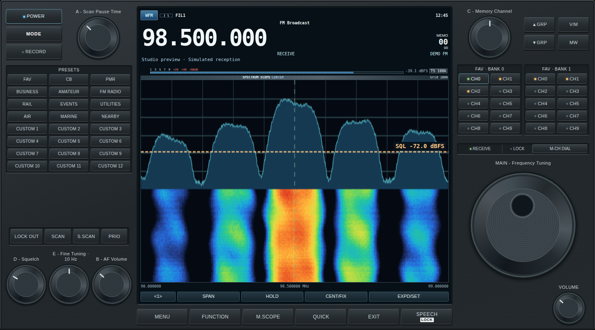
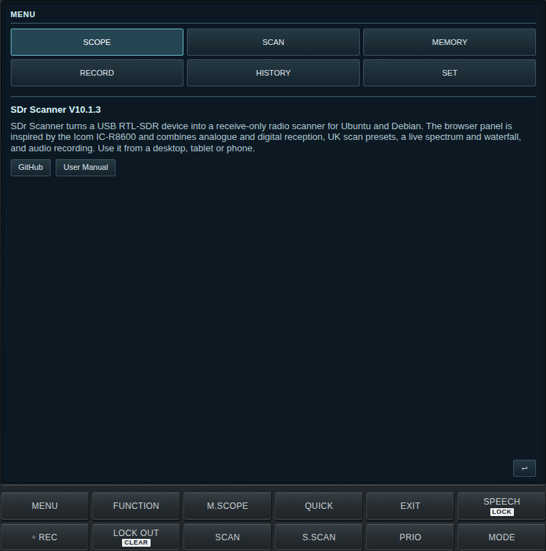
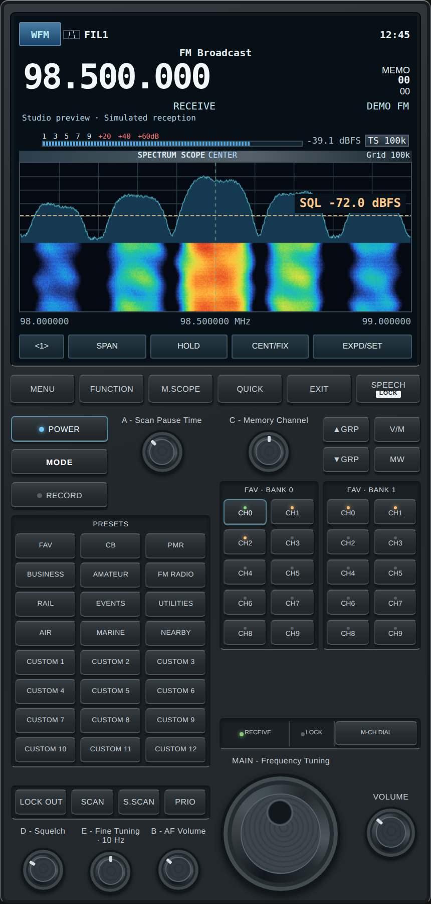

# SDr Scanner V10

SDr Scanner V10.1.4 turns a USB RTL-SDR dongle into a receive-only radio scanner for Ubuntu and Debian. The browser panel is inspired by the Icom IC-R8600 and combines analogue and digital reception, UK scan presets, a live spectrum and waterfall, and audio recording. Use it from a desktop, tablet or phone.

[Install](#install-on-ubuntu-or-debian) · [User manual](docs/V10.md) · [Upgrade](#upgrade-an-existing-installation) · [Network access](#access-from-another-computer) · [Troubleshooting](#troubleshooting)



*Desktop receiver panel with an example FM signal.*

## Features

| Feature | What you can do |
| --- | --- |
| **Analogue reception** | Tune FM, WFM with RDS, AM, synchronous AM, USB, LSB and CW. Use AUTO for common analogue signals, or choose the receive mode directly. |
| **Digital reception** | Receive supported clear DMR, D-STAR, P25 Phase I, dPMR and NXDN-VN signals with DSD-neo. Follow a configured DMR Tier III site, read received DMR SMS, and decode ITA2 RTTY in the browser. |
| **Presets and scanning** | Scan editable UK zones for airband, marine VHF, PMR446, CB, business, amateur radio and other services. Add your own ranges, scan tagged memories, link scan speed to the spectrum span, or check for nearby signals during reception. |
| **Memories and controls** | Save frequencies, modes and filters in memory groups. Use the two front-panel favourite banks for quick recall. Assign functions and sensitivities to individual dials. |
| **Spectrum and second display** | Tune from the spectrum or waterfall, adjust its span and reference level, and open an LCD-only view on a second screen. |
| **Recordings and history** | Arm squelch-triggered MP3 recording, review received signals and available metadata, and play or save recent captured audio. |
| **Network listening** | Keep the SDR on a Linux host and open the panel from other devices. Additional USB tuners can let listeners tune independently. Browser volume, mute and display preferences are local to each browser. |

## Install on Ubuntu or Debian

Use Ubuntu 22.04 or newer, or Debian 12 or newer, with systemd on a 64-bit Intel, AMD or ARM host. Connect the antenna and plug the USB SDR into the Linux host.

The recommended tuner is the **Nooelec NESDR SMArt v5**. The scanner accepts frequencies from **100 kHz to 1.75 GHz** with compatible hardware. Below 25 MHz, reception uses direct sampling and requires a compatible tuner and antenna. [Nooelec receiver specifications](https://www.nooelec.com/store/nesdr-smart-sdr.html)

### Run the full installer

Run the installer as your normal user on the receiver host. It uses `sudo` for system packages and USB permissions. If `curl` is missing, install it first with `sudo apt update && sudo apt install curl`.

```bash
curl -fsSLo install-sdr-scanner.sh https://raw.githubusercontent.com/AshCooperUK/SDR-Scanner/main/install.sh
bash install-sdr-scanner.sh
```

The downloaded script creates its checkout at `~/SDR-Scanner`. You can also clone the repository first and run its installer.

```bash
git clone --branch main https://github.com/AshCooperUK/SDR-Scanner.git
cd SDR-Scanner
bash install.sh
```

The installer sets up the RTL-SDR dependencies, MP3 recording, DSD-neo and the scanner service. The service starts now and at boot. On a desktop it can add an **SDR Scanner** application entry. For a console or SSH installation, use `--headless`. Use `--desktop` to install the application entry explicitly. Follow any prompt to reconnect the receiver or refresh group permissions.

### Open the scanner

1. Open [the local panel](http://127.0.0.1:8766/) on the receiver host. From another device on the same network, open the host’s local name or IPv4 address on port **8766**.
2. Press **POWER**, then click the frequency readout and enter a frequency in MHz. Submitting it selects **AUTO**. Use **MODE** afterwards to select a specific mode.
3. Turn **VOLUME** to adjust the sound. Press that knob to mute or unmute. Hold **POWER** to return to standby.
4. Open the [user manual](docs/V10.md) from **MENU** for the full control guide.



*The LCD menu groups the operating controls and links to the current manual.*



*The receiver panel on a phone.*

## Upgrade an existing installation

In your `SDR-Scanner` checkout, check `git status --short`, save local source edits and [back up your settings](#service-commands-and-backups). On the `main` branch, update the checkout and rerun the installer.

```bash
git pull --ff-only origin main
bash install.sh
```

Refresh the browser after the service starts.

## Service commands and backups

Run these commands as the user who installed the scanner.

```bash
systemctl --user status local-sdr-scanner.service
systemctl --user restart local-sdr-scanner.service
journalctl --user -u local-sdr-scanner.service -n 50
```

From the checkout, `/usr/bin/python3 launcher.py open` starts the service if needed and opens the panel on a desktop or prints its URL in a headless session. Use `/usr/bin/python3 launcher.py stop` to stop the service for the current boot.

To save or restore receiver programming from the panel, use **MENU → SET → Settings Backup**. To make a complete host backup, stop the service with `systemctl --user stop local-sdr-scanner.service` and copy the scanner’s `.scanner-state*.json` files, its `.scanner-radios/` directory if present, and the recordings folder selected under **MENU → RECORD → Recorder Set**. Keep the access settings backup private. Use `systemctl --user start local-sdr-scanner.service` when finished. Volume, mute, display and dial preferences are saved by your browser.

## Access from another computer

### LAN and Tailscale

The installer opens the panel on port **8766**. Direct connections from the same LAN subnet and known Tailscale peers can access it without a PIN. Use the host’s numeric IP if local name resolution fails. If the host uses a firewall, permit TCP **8766** from your intended clients.

When running the app in a terminal, `/usr/bin/python3 app.py` binds to loopback. Add `--listen` to accept network connections. For routed private networks, pass an owner-only JSON access configuration using `--remote-config`. Specify `allowed_cidrs` for the permitted private client networks and `allowed_addresses` for the scanner’s private address or range.

### SSH tunnel

On a client with an SSH connection to the receiver host, forward a local port and leave the session open.

```bash
ssh -N -L 8766:127.0.0.1:8766 your-user@your-server
```

Open [the local panel](http://127.0.0.1:8766/) on the client. If local port 8766 is in use, choose an available local port for the first number in the command and open that port in the browser.

### Use a domain or forwarded IP address

Set a six-digit remote PIN from **MENU → SET → PIN** at the receiver host. The manual explains how to use a one-time setup code from another trusted LAN device. [Remote PIN setup](docs/V10.md#set-a-remote-pin)

Point the reverse proxy or tunnel at the scanner’s port. Preserve the browser’s `Host` header and pass the public scheme in `X-Forwarded-Proto`. Use HTTPS between the browser and the proxy. The read-only LCD at `/lcd` displays receiver activity without a PIN wherever that URL is reachable.

## Troubleshooting

| Symptom | What to check |
| --- | --- |
| **SDR UNAVAILABLE** | Reconnect the dongle to the Linux host and close other SDR software that may be using it. Follow any USB permission instructions from the installer. |
| The display moves but there is no audio | Interact with the panel to enable browser audio, then check **MUTE**, volume, receive mode and squelch. |
| WFM audio works but there is no RDS | Enable **MENU → SET → Display → RDS** and allow time for the broadcast data to decode. |
| Digital mode is unavailable | Run the full installer as the user who runs the service. Check the service journal if the decoder fails to start. |
| No recording appears | Check the selected folder on the Linux host and its permissions. Arm **RECORD** and let a signal pass squelch for at least two seconds. |
| The panel responds locally only | Check that the app is started with `--listen` and that port 8766 is reachable from the client. |

For additional symptoms and settings, see the [user manual](docs/V10.md#troubleshooting).

## Development

Run `python3 -m unittest discover -s tests` from the checkout. The [IC-R8600 coverage audit](reports/SDr%20Scanner%20V10%20parity.md) documents implementation and verification. The [dial and Quick Menu reference](reports/Receiver%20dial%20assignments.md) describes the control design.
